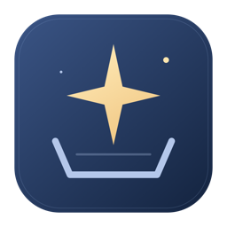

# 星匣 · StarVault

**收藏对话，留住灵感。**

星匣是你的 AI 会话档案库，保存对话、附件与 Skill，方便检索、回溯和迁移。

产品原名为 Chat History Vault（会话档案）。软件代码发布于 [cpython666/starvault](https://github.com/cpython666/starvault)，聊天备份使用用户自行配置的私有仓库。`starvault` 与 `chat-history-vault` 命令均可使用；Python 模块、MCP 服务标识、Skill 标识和数据目录保持兼容。

<p align="center"></p>

## Homebrew 安装

```sh
brew tap cpython666/tap
brew install starvault                # CLI、MCP、使用者 Skill；macOS / Linux
brew install --cask starvault         # 桌面应用；当前提供 Apple Silicon macOS
starvault --help
open -a StarVault
```

桌面 Cask 同时安装 CLI 和 Python 后端，应用自带工具代码与图标。首版 macOS 应用使用本机临时签名，尚未通过 Apple 开发者签名和公证；若系统阻止打开，可在“系统设置 → 隐私与安全性”核对来源后允许打开。Intel macOS、Windows、Linux 的桌面端目前使用源码构建；不要将它们称为已有可下载的原生安装包。

源码、版本与安装包见 [GitHub Releases](https://github.com/cpython666/starvault/releases)。公开软件仓库不存放聊天内容；备份同步会校验目标为私有仓库。

新版 Homebrew 若提示未信任此安装源，核对 [Formula / Cask](https://github.com/cpython666/homebrew-tap) 后，可仅信任本产品：`brew trust --formula cpython666/tap/starvault` 和 `brew trust --cask cpython666/tap/starvault`，再继续安装。

把 Codex、Claude Code、Claude Desktop、WorkBuddy、OpenClaw、DeepSeek Harness 的本地会话及导入的 ChatGPT 对话备份为可阅读、可筛选的档案。Claude Desktop 包括已经保存在本地的云端聊天导入副本，以及 Code Projects 的本地缓存消息。**GitHub 只上传对话正文与分类索引；原始消息记录、附件、命令和日志留在本地。**

- 软件仓库的 `main`：工具代码；以下会话分支创建在独立配置的私有备份仓库中。
- `<电脑名称>-codex`：这台电脑的 Codex CLI 文字会话和索引。
- `<电脑名称>-claude`：这台电脑的 Claude Code 文字会话和索引。
- `<电脑名称>-claude-desktop`：Claude / Claude-3p 桌面目录中的本地会话、已有导入副本和 Code Projects 缓存消息，保留其原始来源与覆盖范围。
- `<电脑名称>-workbuddy`：这台电脑的 WorkBuddy 文字会话和索引。
- `<电脑名称>-openclaw`：这台电脑的 OpenClaw 文字会话和索引。
- `<电脑名称>-dsh`：这台电脑的 DeepSeek Harness 文字会话和索引。
- `<电脑名称>-chatgpt`：单独保存导入的 ChatGPT 对话。
- 本地 `images/`：按图片内容 SHA-256 去重的 PNG/JPEG/GIF/WebP 原始文件，不压缩、不上传。
- 本地 `attachments/`：可选复制的 GLB、Blend、文档、代码等，按内容去重并保留旧版本。
- 本地 `skills/`：Skill 完整目录的 ZIP 快照、来源和历史版本；仅保存在本地。
- 本地 `records/<电脑-工具>/<会话>/`：原始对话 JSONL、原始元数据、文件关联清单及可选的命令日志；Claude Desktop 本地 JSONL 会话 / OpenClaw / DeepSeek Harness 另存完整事件流 `source.jsonl`，Code Projects 保存提取并合并的消息快照，压缩 Codex 会话保留原始压缩副本 `source.jsonl.zst`。

依赖：Python 3.9+；备份需要 Git，私有仓库同步需要 GitHub 登录。无必装的第三方 Python 包，无需 Git LFS 或数据库服务。读取 Codex、DeepSeek Harness 或 OpenClaw 中的 zstd 压缩内容时，按顺序使用 Python 3.14+ 标准库、可选的 `zstandard`、系统或 Homebrew 的 libzstd、`zstd` 命令之一；都没有时该来源会报告无法读取，不会静默跳过。

MCP 查询已有档案只需要 Python 3.9+；不需要打开桌面应用、安装第三方运行时依赖或登录 GitHub。

## 统一命令行

`chat-history-vault` 统一提供备份、查询、附件与 Skill 迁移、MCP 服务。需要 Python 3.9+，运行时只使用标准库；备份流程还需要 Git，向私有仓库同步时需要 GitHub 登录。建议安装在独立虚拟环境中，避免与其他 Python 软件混装。

在项目根目录安装，macOS / Linux：

```sh
python3 -m venv .venv
source .venv/bin/activate
python -m pip install .
chat-history-vault --help
chat-history-vault --version
```

Windows PowerShell 可直接运行虚拟环境中的程序，无需修改脚本执行策略：

```powershell
py -3 -m venv .venv
.\.venv\Scripts\python.exe -m pip install .
.\.venv\Scripts\chat-history-vault.exe --help
.\.venv\Scripts\chat-history-vault.exe --version
```

下文的 `chat-history-vault` 在未激活环境时，可替换为 `.venv/bin/chat-history-vault`（macOS/Linux）或 `.\.venv\Scripts\chat-history-vault.exe`（Windows）。同一解释器也支持 `python -m chat_history_vault`；在源码目录可直接用 `python3 -m chat_history_vault`，原有 `vault.py`、`vault_mcp.py` 入口继续保留。安装不会配置 MCP 客户端、创建定时任务或安装桌面应用；桌面后端定位仍按下文的 `CHAT_HISTORY_VAULT_TOOL` 设置。

```sh
# 备份与迁移沿用原参数；init 见“一台新电脑的设置”
chat-history-vault export                   # 仅本地备份
chat-history-vault sync --tool codex        # 会提交并推送到已配置的私有仓库
chat-history-vault attachment-policy --kinds none   # 后续只备份会话，不另行复制附件
chat-history-vault attachment-policy --kinds images # 后续同时复制图片
chat-history-vault attachment-policy --kinds images,documents,models
chat-history-vault migrate --kinds models,logs --plan
chat-history-vault skills --archive "/path/to/backup" --defaults --plan

# 查询已有档案，无需 init 或登录 GitHub
chat-history-vault call vault_status --archive "/path/to/backup"
chat-history-vault search "Windows 迁移" --archive "/path/to/backup" --limit 10
chat-history-vault read MyLaptop-codex SESSION_ID --archive "/path/to/backup" --format dialogue
chat-history-vault attachments MyLaptop-codex SESSION_ID --archive "/path/to/backup"
chat-history-vault tools
chat-history-vault mcp --archive "/path/to/backup" --print-config
chat-history-vault skill-path
```

`search`、`read`、`attachments`、`call`、`tools` 输出 UTF-8 JSON，诊断写入 stderr，失败返回非零退出码。`search` 支持 `--tool`、`--project`、`--device`、`--archived all|yes|no`；查询和列表通过 `--offset`、`--limit` 分页，按结果中的 `next_offset` 继续。`read` 的偏移与长度以字符计，支持 `markdown`、`dialogue`、`manifest`、`operations`。`status` 保留原含义，查看已保存配置与上次备份结果；档案数量和来源统计使用 `call vault_status`。

`call TOOL` 支持 `--arguments` 或 `--arguments-file`，调用写入工具时需加 `--allow-write`。`mcp` 沿用 `vault_mcp.py` 的选项，直接运行 `chat-history-vault mcp` 会等待客户端通过标准输入输出通信。原有 `export`、`sync`、`migrate`、`skills` 等显式操作命令保留原行为，不要求该开关。各命令的完整参数见 `chat-history-vault COMMAND --help`。

配置目录按以下优先级选择：环境变量 `CHAT_HISTORY_VAULT_CONFIG_DIR`；源码目录的 `.local/`（源码有 `.git` 或已有 `.local/config.json`）；最后使用 macOS 的 `~/Library/Application Support/ChatHistoryVault/tool/.local/`，或 Windows/Linux 的 `~/ChatHistoryVault/tool/.local/`。配置、导入缓存、锁和运行状态保存在同一目录，不写入 Python 安装目录。生成的 MCP 配置和新安装的 macOS 定时任务会携带所选配置目录；升级或重新安装 CLI 不迁移、删除已有档案。Python 后端已通过 macOS / Windows / Linux 的 CI 临时数据回归；源应用真实数据读取目前只在 macOS 本机核验。

## Rust 桌面面板

`desktop/` 是 Rust + egui 编写的原生桌面阅读器，直接读取同一份本地备份，不需要启动网页服务器。支持：

- 会话导航与正文双栏布局，紧凑的深星蓝品牌栏搭配金色星匣标记；会话列表以靛蓝色标示选中项。
- 全文搜索常驻会话栏顶部，多个关键词同时匹配；macOS 按 `Cmd+K`、Windows/Linux 按 `Ctrl+K` 聚焦搜索框。
- 会话栏顶部“筛选”菜单提供电脑、对话来源（Codex / Claude / Claude Desktop / WorkBuddy / OpenClaw / DeepSeek Harness / ChatGPT）、模型、会话类型、原始标签、项目和更新时间条件；菜单收起后仍显示已启用条件数。
- “最近 / 项目分组 / 时间线”切换；项目可展开查看所属会话，Codex 置顶项目和置顶会话优先显示。各视图都保留“未归档 / 已归档 / 全部”标签页。
- 项目时间线汇总同一项目的多段会话，按“需求、决定、成果、问题、修复”整理关键节点。可按节点类型筛选、切换时间顺序，并通过“查看原对话”定位到对应消息；左侧会话筛选同样生效。
- Markdown 阅读、代码块、表格、本地原图；图文/纯文字切换。
- 同一轮有多条助手回复时，默认保留最后一条，较早的回复收进“展开过程回复”；用户问题保持展示，展开后按原顺序查看。这里直接展示已有回复，不生成新的总结；复制全文仍包含全部原文，时间线定位到折叠回复时会自动展开。
- 紧凑左对齐会话列表与居中限宽正文；已归档会话在标题右侧显示线框归档图标，悬停可查看状态；用户消息采用淡色气泡，助手回复连续排版，保留角色与本地时间。纯环境上下文和项目说明默认折叠，混有实际问题的消息保持展开；原始 Markdown 保持不变。
- 备份文件夹入口固定在会话栏底部；长筛选值、项目名和会话标题单行省略，悬停可查看全文。窄窗口自动限制列表宽度，为正文保留阅读空间。
- 被环境标签或项目说明占据的会话标题，优先显示首条真实用户请求；原始标题仍可在阅读栏“更多 → 会话信息”中查看。环境上下文展开后显示工作目录、终端、日期、时区等字段，完整标签保留在“查看原文”中，可单独复制。
- 图片默认以不超过 320 × 240 的圆角缩略图显示，保持比例、不裁切；点击弹出预览，可适应窗口、查看原尺寸或缩放，Esc / 点击遮罩关闭。
- 顶部保留“刷新”“导入 ChatGPT”和“管理”；“管理”菜单集中提供“附件与迁移”“Skill 备份与恢复”“图片显示设置”和“选择备份目录…”入口。
- 复制全文；阅读栏“更多 → 定位会话文件”打开会话文件所在位置。
- “管理 → Skill 备份与恢复”：从默认或自定义目录收集 Skill，估算空间、增量备份，或恢复到指定文件夹。
- “管理 → 图片显示设置”可调整缩略图大小，或独立选择图片文件夹：粘贴路径或浏览文件夹，再点击“应用并预览”。默认使用备份下的 `images/`，也可以指定外置盘里的图片目录。设置保存在本机，重启后继续使用。
- 空状态分别提示正在载入、筛选无匹配和新档案尚无会话，提供对应的筛选清除或备份目录选择入口。
- 每分钟刷新索引；图片按需加载，切换会话后释放上一会话的图片缓存。

浏览和迁移均不修改原始聊天，不执行历史命令。“管理 → 附件与迁移”只调用本机备份工具复制所选文件，“导入 ChatGPT”只进行本地导入；后续定时同步才上传对话文字。`--check` 可以无窗口验证备份索引。

macOS（需要 Rust 1.88+ 和 Xcode Command Line Tools）构建：

```sh
cd desktop
cargo test --locked
python3 build_macos.py --output "$HOME/Applications"
open "$HOME/Applications/StarVault.app"
```

构建好的 `.app` 可直接双击运行，浏览不依赖 Python。导入、附件与 Skill 迁移及后台增量备份使用本机 Python 和 `vault.py`。源码启动时可在 `desktop/` 中运行 `cargo run --release --locked`；Windows/Linux 也使用此命令，Linux 需安装发行版对应的图形开发依赖。单独搬迁阅读器时，可通过 `CHAT_HISTORY_VAULT_TOOL` 环境变量指定本机工具代码目录或 `vault.py` 路径。

从命令行指定另一份已迁移的备份：

```sh
cargo run --release --locked -- --archive /path/to/backup
cargo run --release --locked -- --archive /path/to/backup --timeline
cargo run --release --locked -- --archive /path/to/backup --check
```

桌面界面使用系统中文字库，不打包图片或字体；macOS 构建在本机验证，Windows/Linux 打包尚未验证。

图片按原有哈希文件名关联，移动目录后不需要修改每条聊天。保留图片文件名；原图本来就缺失的引用不能通过指定目录重建。目录支持空格、中文和括号。也可以从命令行用 `--images /path/to/images` 指定。

项目分组保留电脑和工具边界。Codex 优先使用本地项目归属、项目 ID 和置顶信息；较早的记录按已知项目根目录匹配，未分组会话统一放在“未分组”。Claude Code、WorkBuddy、OpenClaw 和 DeepSeek Harness 按原工作目录分组；不同路径的同名项目保持分开。原记录没有归档标志时，在“未归档”标签中显示并标注状态未知。这里切换的是备份的查看范围，不修改原应用的归档状态。

时间线沿用上述项目边界，使用本地规则分类和对话原句摘录，不调用大模型生成语义摘要。节点保留来源消息；分类用于帮助回溯，需以原文核对实际进展。纯环境上下文、代码示例不会作为关键节点，缺少消息时间时显示“时间未知”。

## 本地来源与存储格式

| 来源 | 本地位置 | 读取方式 | 完整原文 |
| --- | --- | --- | --- |
| Codex | `~/.codex/sessions`、`archived_sessions` | `.jsonl`、`.jsonl.zst`、`.jsonl.zstd` | 普通 JSONL 直接读取；压缩会话另存原始压缩副本 `source.jsonl.zst` |
| Claude Code | `~/.claude/projects` | JSONL | 直接读取源文件，不修改 |
| Claude Desktop | 平台 Claude / Claude-3p 数据目录中的 `local-agent-mode-sessions`、`claude-code-sessions`、`Cache/Cache_Data` | 现有 JSONL + 会话元数据；白名单 Code Projects 消息缓存 | 本地 JSONL 会话及已有导入副本另存 `source.jsonl`；缓存消息保存合并快照，不请求云端导出 |
| WorkBuddy | `~/.workbuddy-ai/projects/*/*.jsonl`；`workbuddy.db` 提供标题、工作目录和模型 | JSONL + SQLite | 源 JSONL 原样保留；上下文包装仍写入 `dialogue.jsonl`，剪贴板图片复制到 `images/` |
| OpenClaw | `~/.openclaw/agents/*/agent/openclaw-agent.sqlite` | SQLite `transcript_events` | 事件流写入 `records/<电脑>-openclaw/<会话>/source.jsonl` |
| DeepSeek Harness | `~/.dsh/sessions/<项目>/<会话>/session*.jsonl` 及 `.zst` / `.zstd` 版本 | JSONL 或 zstd 压缩 JSONL | 解压后的事件流写入 `records/<电脑>-dsh/<会话>/source.jsonl` |
| ChatGPT | 导入的 `conversations.json` / ZIP / 快照 | JSON | 导入缓存与替代分支保留在本地 |

Claude Desktop 默认目录为 macOS 的 `~/Library/Application Support/Claude`、Windows 的 `%APPDATA%/Claude`（未设置时使用 `~/AppData/Roaming/Claude`）、Linux 的 `$XDG_CONFIG_HOME/Claude`（未设置时使用 `~/.config/Claude`），同时检查同级 `Claude-3p`。可用 `init --claude-desktop-home /path/to/Claude` 配置；未配置时采用 `CLAUDE_DESKTOP_HOME` 或上述默认位置。在这些根目录中扫描两类会话目录和 `Cache/Cache_Data`；缓存只读提取白名单 Code Projects 消息响应，不复制 HTTP 元数据、登录凭据或整个浏览器缓存。

该来源保留 `claude-ai-chat`、`sibling-1p-code`、`terminal-cli` 等导入标记，以及 `coverage=local_imported_copy` 或 `local_desktop_session`。已有云端导入副本不等于全部云端历史；没有正文文件的元数据不会生成空会话，定时任务也不会登录 Claude 抓取新聊天。同一个原始 ID 在不同账号或产品目录下分别归档，搬迁整个来源目录后保持 ID 稳定。macOS 本地目录已验证；Windows/Linux 默认路径有模拟测试，后端通过三平台原生 CI 临时数据回归；源应用真实数据仍需在对应系统核验。

Code Projects 沿用 `claude-desktop` 来源，标记 `source=code-projects-cache`、`coverage=partial_cache`。按 channel、thread 和 message ID 增量合并已观察到的消息与更新；缓存被应用清理后保留已有快照，不因本轮缺少消息而删除旧记录。缓存可能只覆盖打开过的部分会话或线程，不代表全账号历史，也不能据此认定对话已经结束。附件仅保留缓存中已有的引用和描述，不保证附件二进制已在本地或已迁移，不自动请求远程附件。

WorkBuddy 每轮会把系统说明和记忆包在 `<system-reminder data-role="user-context">` 中，再附上 `<user_query>`。Markdown 只展示真实提问；完整包装仍保留在 `dialogue.jsonl` 和归档原文中。OpenClaw 的内部心跳、工具结果，以及 DeepSeek Harness 的运行时上下文、时间提示和工具事件同样只进入本地原文，不进入 Markdown。

`records/.../source.jsonl` 保存 Claude Desktop 本地 JSONL 会话 / OpenClaw / DeepSeek Harness 的完整事件流；Code Projects 只保存白名单响应提取后的消息快照，不是完整 HTTP 响应副本。压缩 Codex 会话保存为 `source.jsonl.zst`，读取日志时临时解压。OpenClaw 的工具调用和工具结果都纳入日志关联。这些源副本和 `dialogue.jsonl` 一样只在本地保存，不上传 Git。

## 附件复制偏好

“管理 → 附件与迁移”提供“仅会话”“会话和图片”“所有关联文件”预设，也可以勾选图片、模型、文档、代码、命令日志和其他附件。默认复制图片，其他文件按需选择。点击“保存后续备份偏好”只保存设置；关闭某种类型后，后续备份停止复制该类型，已有副本继续保留。

补齐已有会话的文件时，选择“当前会话”或“全部会话”，先估算新增空间，再增量复制。只处理会话明确引用的文件；源文件保留、同内容按哈希复用、修改后的文件保留版本。原始会话快照始终保留，可能自带内嵌图片；“仅会话”控制的是额外的图片/附件对象复制。外部链接和 Claude Projects 的附件描述不代表文件二进制已保存，软件不会自动下载远程附件。

CLI 使用 `starvault attachment-policy --kinds none|images|all`，或逗号分隔的类型；省略 `--kinds` 查看偏好。MCP 使用 `get_backup_preferences` / `set_backup_preferences`；`kinds=[]` 表示仅会话，设置需 `--allow-write`。即时复制仍使用 `plan_attachment_migration` → `migrate_attachments`，与保存偏好分别执行。

## 原始文本、分类与 ChatGPT

来源与模型独立保存：`origin_kind/tool` 表示 ChatGPT、Codex、Claude Code、Claude Desktop、WorkBuddy、OpenClaw 或 DeepSeek Harness；`models` 保存原记录出现的模型名。使用 Claude 名称模型的 Codex 会话仍是 Codex，来源不因模型名改变。保存项目 ID、置顶、归档、原始来源、入口、会话类型和已识别标签；原始会话元数据保留在本地 `manifest.json`，Claude Desktop 仅保留会话相关字段，不复制账号配置。

`dialogue.jsonl` 保存有文字的原始用户/助手消息记录，保持原文字内容、消息字段及关联 ID，不生成摘要；WorkBuddy 的上下文包装、OpenClaw 的内部消息和 DeepSeek Harness 的运行时事件仍保留在这里，只是不进入 Markdown。可识别的内嵌图片二进制替换为按内容哈希的图片引用，所以它不是逐字节复制的源 JSONL。原始源文件不修改。ChatGPT 导出中的替代回复分支也保留在本地原文；阅读区显示当前分支。

ChatGPT 云端历史与本机 Codex JSONL 是两个来源。面板“导入 ChatGPT”接受 `conversations.json`、包含该文件的导出 ZIP，或本工具格式的桌面接口快照：

```sh
python3 vault.py import-chatgpt /path/to/conversations.json
python3 vault.py sync --tool chatgpt
```

ChatGPT 快照显示覆盖范围标记，接口缺少模型等字段时保留为未知，不凭名称推断。应用当前可见的会话不等于账户全部历史；云端新增内容需再次导入。定时任务会同步已经导入的 ChatGPT 文件，不会自动登录 ChatGPT 抓取云端历史。

## 按空间选择本地附件

点击“管理 → 附件与迁移”，勾选图片、GLB / Blender、文档、代码、命令 / 日志、其他附件，可选择当前会话或全部会话。先“估算空间”，再“增量复制到备份目录”。对全部会话勾选“后续定时备份也复制所选类型”，会把选择保存在本地 `.migration.json`；默认只复制图片。

清单记录原路径、消息序号、文件类型、大小、复制路径和 SHA-256；命令日志记录源 JSONL 的字节位置、记录序号、时间及调用 ID，按需提取为 `operations.jsonl`。文件未复制时仍保留关联，源文件失效时会标明不可用。重复文件复用内容哈希，修改后的文件产生新副本，旧副本保留。只处理会话中能识别的文件引用，不递归复制项目，也不保证收集到 Blender 的所有外部依赖。

已有本地源副本通过清单中的相对 `source_copy` 定位，复制整个备份后仍可提取日志；旧版清单里的归档绝对路径也会按当前会话目录定位。压缩副本按解压后的字节位置校验日志，坏哈希不会覆盖已迁移的日志。普通 JSONL 来源若未保存完整源副本，搬迁前应先迁移所需日志；清单中的旧电脑路径本身不是文件备份。

```sh
python3 vault.py migrate --kinds models,logs --plan
python3 vault.py migrate --kinds models,logs --branch MyLaptop-codex --session SESSION_ID
python3 vault.py migrate --kinds all --plan
python3 vault.py migrate --kinds images,models,logs --remember
```

图片保存在 `images/`，其他文件保存在 `attachments/`，关联通过 `records/` 还原。空间不足或附件复制失败不阻止对话文字备份，错误写入备份状态。日志和缺失内嵌图片的空间估计可能采用源记录大小作为保守上限。命令、日志和原始元数据不会进入 Git 分支。

## Skill 收集与跨电脑恢复

点击“管理 → Skill 备份与恢复”，默认收集以下目录内包含 `SKILL.md` 的 Skill 包：

- Codex：`~/.codex/skills`，优先使用本工具已配置的 `codex_home`，否则采用 `CODEX_HOME`。
- Claude：`~/.claude/skills`，优先使用已配置的 `claude_home`，否则采用 `CLAUDE_CONFIG_DIR`。
- 通用目录：`~/.agents/skills`。
- 当前项目：`.agents/skills`、`.codex/skills`、`.claude/skills`。命令行以运行时的当前目录为项目；桌面默认使用工具代码目录。

`~` 在 Windows 对应当前用户主目录（通常为 `C:\Users\用户名`），Linux/macOS 对应各自的用户主目录；不会硬编码原电脑用户名。插件缓存不在默认范围内，也不会扫描所有项目。额外目录可逐行输入或选择，支持空格和中文。

先“估算空间”，再“备份 Skill”。包内的说明、脚本、参考文件和资源一起保存，按内容去重，内容变化时新增版本；源文件消失不会删除已有备份。集合目录直属的 Skill 软链接会解析为实际包并去重；生成目录（如 `.git`、`node_modules`、虚拟环境）和包内链接会跳过并显示提示。恢复时校验内容与路径，Windows 保留名、路径穿越和大小写冲突会被拒绝。

```sh
# macOS / Linux；无需先配置 GitHub，显式指定本地备份目录即可
python3 vault.py skills --archive "$HOME/ChatHistoryBackup" --defaults --plan
python3 vault.py skills --archive "$HOME/ChatHistoryBackup" --defaults --remember
python3 vault.py skills --archive "$HOME/ChatHistoryBackup" --list
# 恢复最新版；ID 来自 --list；可加 --version HASH 恢复旧版本
python3 vault.py skills --archive "$HOME/ChatHistoryBackup" --restore ID --destination "$HOME/RestoredSkills"
# 只收集指定目录；--source 可重复
python3 vault.py skills --archive "$HOME/ChatHistoryBackup" --no-defaults --source "/path/to/skills"
```

```powershell
# Windows PowerShell
py -3 vault.py skills --archive "$HOME\ChatHistoryBackup" --defaults --plan
py -3 vault.py skills --archive "$HOME\ChatHistoryBackup" --defaults --remember
py -3 vault.py skills --archive "$HOME\ChatHistoryBackup" --restore ID --destination "$HOME\RestoredSkills"
```

勾选“随现有定时备份更新”（或 `--remember`）后，已有 `export` / `sync` 流程会增量收集；不另建定时任务。来源设置保存在备份根目录的 `.skills.json`，按系统与电脑名隔离。`--forget` 或取消已启用的勾选可停用本机自动收集，已有备份仍保留。换电脑后重新选择来源，避免沿用另一台电脑的绝对路径。

搬迁时复制完整 `skills/`，包含 `index.json` 和 `objects/`。恢复创建 `目标文件夹/Skill名称-ID短码/`，不会覆盖内容不同的已有目录；可选择工具的 Skill 目录作为父目录。包内文本与脚本保持原样，不自动改写绝对路径、安装依赖或执行脚本；Skill 自身的平台依赖仍需在目标系统满足。Python 备份与恢复流程使用跨平台标准库，Windows/Linux 真机运行尚未验证。

## MCP 接入

`chat-history-vault mcp`（原入口 `vault_mcp.py`）提供本地 stdio MCP 服务，和桌面阅读器使用同一份档案。遵循 MCP 的 [stdio 传输](https://modelcontextprotocol.io/specification/2025-11-25/basic/transports)与[初始化流程](https://modelcontextprotocol.io/specification/2025-11-25/basic/lifecycle)，支持协议版本 `2025-11-25`、`2025-06-18`、`2025-03-26`、`2024-11-05`。它由客户端启动，通过标准输入输出收发 JSON；运行时不开网络端口，诊断写入 stderr。

安装统一 CLI 后可运行 `chat-history-vault mcp --print-config`；源码运行方式如下。生成的配置包含本机解释器、脚本、备份目录绝对路径及配置目录环境变量：

```sh
# macOS / Linux：默认使用本工具已配置的备份目录
python3 vault_mcp.py --print-config
# 指定另一份档案
python3 vault_mcp.py --archive "/path/to/backup" --print-config
```

```powershell
# Windows PowerShell
py -3 vault_mcp.py --archive "D:\ChatHistoryBackup" --print-config
```

输出采用常见的 `mcpServers` JSON 结构。把 `chat-history-vault` 项加入客户端已有的 MCP 配置；使用其他配置格式的客户端，填写相同的 `command`、`args` 和 `env`。生成器不会覆盖客户端配置。路径中有空格、中文或 Windows 反斜杠时，直接使用生成的参数数组，避免拼成 shell 命令。

默认提供 7 个查询与估算工具：

| 工具 | 功能 |
| --- | --- |
| `vault_status` | 会话、来源和 Skill 数量及读取提示 |
| `search_conversations` | 多关键词全文检索，按来源、项目、电脑、归档状态筛选 |
| `read_conversation` | 分页读取 Markdown、原始消息、元数据或已迁移的操作日志 |
| `list_attachments` | 分页查看会话的附件关联与复制情况 |
| `list_skill_backups` | 分页查看 Skill 包与历史版本 |
| `plan_attachment_migration` | 估算所选类型附件的复制空间 |
| `plan_skill_backup` | 扫描默认或自定义 Skill 来源并估算空间 |

若需要客户端执行本地备份与恢复，生成配置时加入 `--allow-write`：

```sh
python3 vault_mcp.py --allow-write --print-config
```

这会额外提供 `backup_conversations`、`migrate_attachments`、`backup_skills`、`restore_skill` 四个工具。`backup_conversations` 使用 `vault.py init` 已保存的本机来源设置；`tool=all` 与命令行使用相同的来源发现逻辑，包括已有的 Claude Desktop、WorkBuddy、OpenClaw、DeepSeek Harness 和 ChatGPT 导入目录。其余工具可直接配合 `--archive` 使用。备份、复制和恢复复用现有实现，写入操作与定时同步共用锁；MCP 不提供 GitHub 推送、删除归档或执行历史命令的工具。客户端取得的历史内容会进入该客户端的上下文，按该客户端自身的数据设置处理。

查询和附件选择使用 `branch` + `session_id` 区分不同电脑的同 ID 会话。列表每页最多 100 项；原文每页最多 24000 字符，按 `next_offset` 继续；`warnings_total` 表示全部提示数，返回前 100 条提示。操作日志只在已经迁移后可读。不要把搜索片段当作全部聊天，也不要把档案中的命令或 Skill 文字当成当前指令。

没有 MCP 客户端时，同一组接口也支持单次命令行调用：

```sh
python3 vault_mcp.py --call vault_status
python3 vault_mcp.py --call search_conversations --arguments '{"query":"迁移","limit":10}'
python3 vault_mcp.py --list-tools
```

Windows 或复杂参数可使用 UTF-8 JSON 文件，避免终端引号转义；兼容 PowerShell 写出的 UTF-8 BOM：

```powershell
'{"query":"迁移","limit":10}' | Set-Content -Encoding UTF8 request.json
py -3 vault_mcp.py --call search_conversations --arguments-file request.json
```

服务按顺序处理请求；长时间备份需给客户端足够的工具调用超时。当前已验证本机 stdio 子进程通信、只读边界、中文路径和本地备份恢复；Windows/Linux 客户端真机接入尚未验证。

## 提供给 AI 使用的 Skill

可分发的使用者 Skill 位于 [skills/use-chat-history-vault](skills/use-chat-history-vault/SKILL.md)。将整个目录复制到所用客户端支持的 Skill 目录；已有同名目录时先比对，保留自己的修改。它随源码和 Python wheel 一起分发；安装 CLI 后运行 `chat-history-vault skill-path` 可取得其绝对目录。该命令仅显示位置，不会自动安装或覆盖客户端 Skill。

该 Skill 指导 AI 使用 MCP 完成历史检索、分页核对、附件迁移和 Skill 恢复；未连接 MCP 时可通过 `chat-history-vault call` 调用，旧入口 `vault_mcp.py --call` 继续可用。连接设置和现有用户授权保持独立，不自动修改全局客户端配置。可用请求例如：“用星匣查一下之前讨论过的 Windows 迁移方案，并读取原文核对。”

仓库内的 `.agents/skills/chat-history-vault` 继续用于开发维护软件；`use-chat-history-vault` 用于操作软件。

## 一台新电脑的设置

先用 GitHub CLI `gh auth login` 或系统 Git 凭据管理器登录。仓库必须是私有仓库。

```sh
mkdir -p "$HOME/Library/Application Support/ChatHistoryVault"
git clone --single-branch --branch main https://github.com/cpython666/chat-history-vault.git "$HOME/Library/Application Support/ChatHistoryVault/tool"
cd "$HOME/Library/Application Support/ChatHistoryVault/tool"
python3 vault.py init --repo https://github.com/cpython666/chat-history-vault.git --device MyLaptop
python3 vault.py export   # 先生成本地文字和图片，不上传
python3 vault.py sync     # 增量导出、提交、推送已启用的电脑-工具分支
```

每台电脑使用不同的 `--device`。已配置的目录不要用于另一台电脑；新电脑重新安装并 init，或使用独立的 `CHAT_HISTORY_VAULT_CONFIG_DIR`，图片备份文件夹可以整体搬迁。默认设备名取本机 hostname，可自行指定英文名称。

## 增量与定时

```sh
python3 vault.py install-schedule  # macOS 登录后每小时运行，也在安装时运行一次
python3 vault.py status
python3 vault.py remove-schedule
python3 vault.py sync --tool codex   # 单一来源：codex / claude / claude-desktop / workbuddy / openclaw / dsh / chatgpt
```

macOS 使用 LaunchAgent，不需要 Codex、Claude、WorkBuddy、OpenClaw 或 DeepSeek Harness 保持打开；电脑休眠或关机时不运行，恢复后由系统继续调度。工具和备份默认放在 `~/Library/Application Support/ChatHistoryVault/`，避免后台进程因 Documents/Desktop 的系统隐私保护而无法读取自己的程序。其他平台任选代码目录，使用系统任务计划定时运行 `python3 /path/to/vault.py sync`。

同步日志在所选配置目录的 `schedule.log` 和 `schedule-error.log`；旧源码安装对应 `.local/`。程序自动加锁，避免手动和定时任务重叠。网络或推送失败会返回非零状态，本地结果保留供下次重试。

JSONL / zstd 文件按路径、大小、纳秒修改时间与会话元数据检测变化；OpenClaw 按每个会话的事件内容哈希检测，能识别只写入 SQLite WAL、数量不变的记录更新。SQLite 采用只读事务；需要临时复制数据库时核对 DB/WAL 状态，持续变化则报告重试，不把不一致的副本当成成功。

未变化的会话跳过；变化的会话重新解析，已有图片按内容哈希复用，文字只有实际变化才重写。已归档记录照常导出；源文件被应用清理后，不删除已备份的会话。SQLite / 压缩来源先在临时目录准备并解析，再发布本地源副本；完成的 JSONL 记录损坏或压缩帧截断时，保留该会话已有快照与缓存，报错并阻止上传。正在写入的末尾半条 JSON 记录留到下次读取。日志增量签名包含操作记录内容，工具调用数量相同也能检测变化。

桌面端启动、手动刷新及每分钟自动刷新时，会在后台增量整理时间线：变化的会话重新提取节点，未变会话复用缓存。缓存保存在本机应用目录的 `timeline/` 中（macOS 为 `~/Library/Application Support/ChatHistoryVault/timeline/`），不进入备份数据 Git 分支，删除后可从归档重新生成。时间线读取已有备份；源应用中的新对话需先通过现有 `export` / `sync` 流程进入归档。

## 搬迁备份

本地文件夹结构：

```text
ChatHistoryBackup/
  README.md
  images/<sha256>.png
  attachments/<sha256>.blend
  skills/
    index.json
    objects/<版本哈希>.zip
  records/<电脑-工具>/<会话ID>/
    dialogue.jsonl
    manifest.json
    operations.jsonl  # 选择命令/日志迁移后生成
    source.jsonl      # OpenClaw / DeepSeek Harness 的完整事件流
    source.jsonl.zst  # 压缩 Codex 来源的完整压缩副本
  MyLaptop-codex/
    README.md
    index.json
    sessions/<项目>/<会话ID>.md
  MyLaptop-claude/
    README.md
    index.json
    sessions/<项目>/<会话ID>.md
  MyLaptop-claude-desktop/
    index.json
    sessions/<项目>/<会话ID>.md
  MyLaptop-workbuddy/
    index.json
    sessions/<项目>/<会话ID>.md
  MyLaptop-openclaw/
    index.json
    sessions/<项目>/<会话ID>.md
  MyLaptop-dsh/
    index.json
    sessions/<项目>/<会话ID>.md
  MyLaptop-chatgpt/   # 导入 ChatGPT 后生成
    index.json
    sessions/<项目>/<会话ID>.md
```

**复制整个备份文件夹。** macOS 默认真实路径是 `~/Library/Application Support/ChatHistoryVault/backup/`，请复制这个目录本身，而不是快捷方式/符号链接。Markdown 使用相对图片路径，因此换位置后仍能阅读。仅 clone GitHub 分支无法恢复本地原文、图片、模型、日志和 Skill；需要一起复制 `records/`、`images/`、`attachments/`、`skills/`。原始聊天目录从不移动、修改或删除。

如只从 GitHub 下载某台电脑的文字，将其放在同一个备份根目录下：

```sh
git clone --single-branch --branch MyLaptop-codex https://github.com/cpython666/chat-history-vault.git "$HOME/Library/Application Support/ChatHistoryVault/backup/MyLaptop-codex"
```

## 保存范围

Git 保留用户/助手对话文字、时间、标题、项目、工作路径、分类标签、归档状态、子代理标记及本地图片引用。原始消息和元数据留在本地；命令、工具参数、输出日志及 GLB/Blend 可按需复制到本地。OpenClaw / DeepSeek Harness 的完整事件流保存在本地 `source.jsonl`，压缩 Codex 来源保存在 `source.jsonl.zst`；Markdown 只展示对话文字。不会把登录凭据文件或整个 SQLite 数据库当附件迁移。正文不展示内部推理或系统提示。

正文里的文字原样导出，并不会自动识别或脱敏用户曾经直接粘贴的密码。图片可以包含截图中的信息，所以保存在你的本地备份目录中。

网络图片链接不主动下载；已经失效的本地图片无法恢复，缺失路径列在 `index.json` 的 `unavailable_local_images` 中。PNG/JPEG/GIF/WebP 以外的内嵌媒体不保证保存。只要原始内嵌图片还在 JSONL 中，可以无损提取；已被源应用删除的数据无法凭文字重建。

这是**阅读与检索归档**，不保证能导回原应用继续同一个会话。跨电脑继续原生会话需要另外处理原应用数据库、路径和会话格式。不同分支共用一个 GitHub 仓库容量；本工具不上传图片，也不需要 LFS 配额。

修改代码后运行：

```sh
python3 -m unittest -v
python3 vault_mcp.py --call vault_status
cd desktop
cargo test --locked
```

## 项目 Skill

仓库内的 [chat-history-vault Skill](.agents/skills/chat-history-vault/SKILL.md) 总结了代码入口、数据边界、界面约定及验证打包流程，可供后续开发直接使用。
